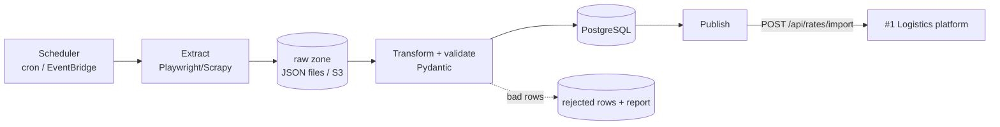

# #4 Freight / Price Data Pipeline — Plan

**Pitch:** A scheduled pipeline that crawls public freight and port data, cleans and validates it, stores it in PostgreSQL and pushes rates to the logistics platform.

**Status (2026-10-02):** built and verified locally. 53 tests (+1 browser) pass; ruff, ruff format and strict mypy are clean; 83% coverage. Live publish into project #1: 290 rates, 0 rejected. Remaining: Docker and CI first run on GitHub, `git init` + push.

**Stack:** Python 3.12+ · Playwright (JS pages) / Scrapy or httpx (static) · Pydantic · PostgreSQL · SQLAlchemy/Alembic · pytest · Docker · cron (EC2) or AWS Lambda + EventBridge

> Only crawl sites whose terms allow it, respect `robots.txt` and rate limits. If no good public source exists, include a **mock freight-rate site** in the repo and crawl that. It's safer and always online.

## Architecture (target)

## Steps

### 1. Setup (days 1–2)
- [x] Project layout (`src/pipeline/{extract,transform,load,publish}`), `pyproject.toml`, ruff + mypy, pytest, CI
- [x] Mock rate site (small static/JS site in `mock-site/`) as a reliable source

### 2. Extract (days 3–5)
- [x] Crawlers with retries + exponential backoff, timeouts, user-agent, rate limiting
- [x] Save raw responses (replayable and testable)

### 3. Transform + load (week 2)
- [x] Pydantic models, currency/unit normalization, dedup, validation. Rejected rows go to a report
- [x] Idempotent upserts into PostgreSQL; `pipeline_runs` table (start, end, rows in/out/rejected, status)

### 4. Schedule + observe (week 2)
- [x] Daily schedule; structured JSON logs; failure alert (email/Slack webhook)
- [x] Publish step → #1's import API (API key)

### 5. Docs
- [x] README, ER diagram, sample run output, data-quality report screenshot
- [x] ADRs: `0001-playwright-vs-scrapy.md`, `0002-raw-zone-for-replay.md`, `0003-idempotent-loads.md`
