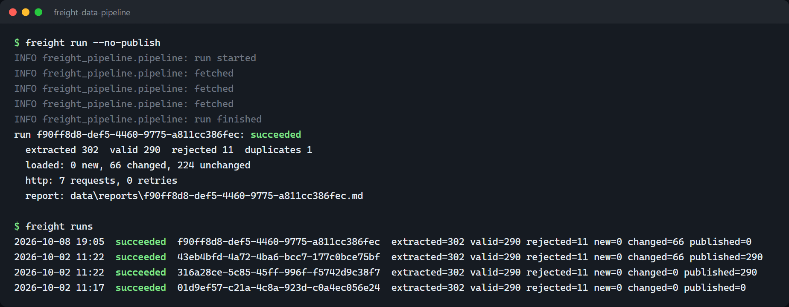
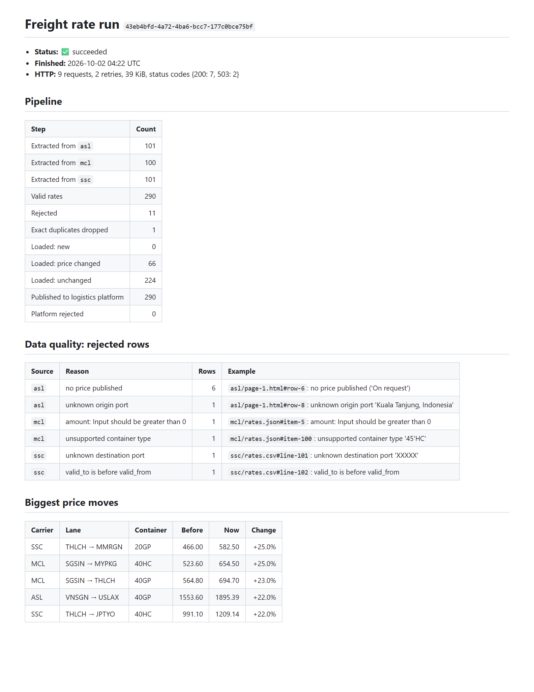
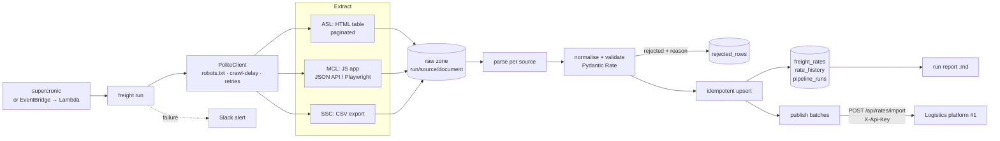
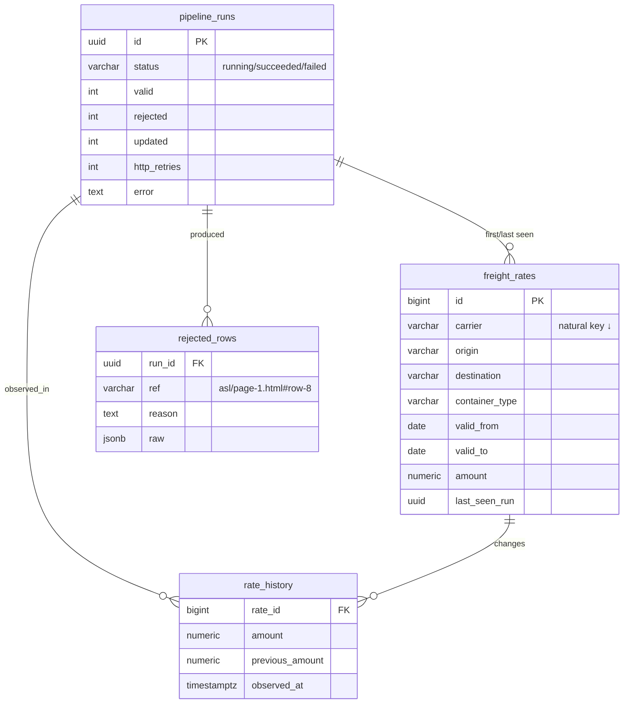

# Freight Rate Pipeline

> A scheduled crawler + ETL that collects carrier freight rates from three very different sources (HTML pages, a JavaScript app, a CSV export), validates and normalises them, keeps price history in PostgreSQL, and publishes them to the [logistics platform](https://github.com/arkarlin528/logistics-tracking-platform).

[](https://github.com/arkarlin528/freight-data-pipeline/actions/workflows/ci.yml)


**Sample output:** [a real run report](docs/sample-run-report.md). It shows a flaky site retried, 66 price changes detected, and 11 bad rows explained.

```text
$ freight run
run 43eb4bfd-…: succeeded
  extracted 302  valid 290  rejected 11  duplicates 1
  loaded: 0 new, 66 changed, 224 unchanged
  published 290 (0 rejected by platform)
  http: 9 requests, 2 retries
```

Part of a [connected logistics portfolio](https://github.com/arkarlin528): the rates this pipeline publishes show up in the logistics platform's rate search, and the AI assistant answers questions about them.

> The carriers, their websites and their prices are **fictional**: the repo ships its own [mock carrier site](mock_site/app.py), so it never scrapes anyone else.

## Screenshots

| A real run from the CLI | The run report it writes ([Markdown](docs/sample-run-report.md)) |
|---|---|
|  |  |

## Tech stack

| Area | Choice | Why |
|---|---|---|
| Language | **Python 3.12**, typed (`mypy --strict`) | Fast to write parsers; types keep the data model honest |
| HTTP | **httpx** + **tenacity** | Timeouts, retries with backoff, `Retry-After`, robots.txt + crawl-delay ([ADR-0004](docs/adr/0004-politeness-and-resilience.md)) |
| Parsing | **BeautifulSoup + lxml** (HTML), `csv` (CSV), JSON API; **Playwright** for the JS app when needed | The simplest tool per source ([ADR-0001](docs/adr/0001-api-first-browser-when-needed.md)) |
| Validation | **Pydantic v2** | One `Rate` model; every failure becomes a reported rejection |
| Storage | **PostgreSQL 17**, **SQLAlchemy Core**, **Alembic** | Idempotent upserts with `ON CONFLICT`, append-only history, versioned schema |
| CLI | **Typer** | `freight run / replay / runs / migrate` |
| Scheduling | **supercronic** in Docker (Lambda + EventBridge as the AWS option) | [ADR-0006](docs/adr/0006-scheduling.md) |
| Quality | pytest, respx, ruff, mypy, GitHub Actions (+ daily run), gitleaks | |

## Architecture



## What each source needed

| Carrier | Source | Messiness handled |
|---|---|---|
| Andaman Sea Lines | Server-rendered **HTML**, 5 pages via "Next ›" links | Port *names* (`Laem Chabang, Thailand`), `USD 1,250.00`, `40' High Cube`, `01 Oct 2026 – 31 Oct 2026`, "On request" rows, a row repeated across pages, an unknown port |
| Mekong Container Lines | **JavaScript** app; empty HTML shell | Reads the JSON API behind it (default) or renders with **Playwright** (`browser` mode, proven identical); prices in cents, `40'HC`, a zero price, unsupported `45'HC` |
| Straits Shipping Co. | **CSV** export | Semicolon separator, comma decimals (`1234,50`), `dd/mm/yyyy`, unknown port `XXXXX`, reversed validity dates |

Every row becomes a validated `Rate` or a `Rejection` with a reason and a pointer to the exact source row (`asl/page-1.html#row-8`). Nothing is dropped silently.

## Database



Schema changes are versioned with **Alembic** (`freight migrate`), and the tests run the real migrations.

## Interfaces (CLI and API)

The pipeline has no server of its own. You drive it from the **CLI**, and it **publishes** to the logistics platform's import API.

| Command | What it does |
|---|---|
| `freight run [--source asl --source mcl] [--no-publish]` | Crawl → validate → load → publish → report (all sources by default) |
| `freight replay <run-id> [--publish]` | Re-process a run's saved raw files without crawling ([ADR-0002](docs/adr/0002-raw-zone-and-replay.md)) |
| `freight runs [--limit 10]` | Run history with counts |
| `freight migrate` | Apply Alembic migrations |
| `freight --json-logs …` | JSON log lines for servers / CloudWatch |

**Publishing to [#1](https://github.com/arkarlin528/logistics-tracking-platform):** `POST /api/rates/import` with the `X-Api-Key` header, in batches of up to 500. The import is idempotent per rate, so a batch retried after a timeout never creates duplicates. The platform answers with per-row rejections, which go into the run report.

```json
{
  "source": "freight-data-pipeline",
  "rates": [
    { "origin": "THLCH", "destination": "SGSIN", "carrierCode": "SSC", "containerType": "40HC",
      "currency": "USD", "amount": 533.80, "validFrom": "2026-10-01", "validTo": "2026-10-31" }
  ]
}
```

## Run it

```bash
python -m venv .venv && .venv/Scripts/activate        # or source .venv/bin/activate
pip install -e ".[dev,browser]"
cp .env.example .env                                  # set FREIGHT_DATABASE_URL etc.

uvicorn mock_site.app:app --port 8900                 # the fictional carrier sites
freight migrate                                       # create tables
freight run --no-publish                              # crawl → validate → load → report
freight runs                                          # history
freight replay <run-id>                               # re-process raw files, no crawling
```

To publish into the logistics platform, set `FREIGHT_LOGISTICS_API_URL` and `FREIGHT_LOGISTICS_API_KEY`.

To demo a flaky carrier or moving prices, start the mock site with `MOCK_FLAKY_EVERY=4 MOCK_MARKET_DAY=1`.

Docker (PostgreSQL + mock site + scheduled pipeline): `cp .env.example .env && docker compose up --build`.

## Testing & quality

```bash
pytest                       # 53 tests: parsers, sources, HTTP politeness, publisher, full pipeline on PostgreSQL
pytest -m browser            # Playwright renders the JS page (needs a running mock site)
ruff check . && ruff format --check . && mypy      # lint, format, strict typing
```

- **Pipeline tests** run the in-process mock site against real PostgreSQL. They cover:
  - first load;
  - an idempotent second run;
  - market moves recorded in history;
  - a flaky site carried through by retries;
  - offline replay;
  - a failing run recorded as failed.
- **HTTP tests** (respx) cover:
  - retry on 503 and connection reset, honouring `Retry-After`;
  - giving up after N attempts;
  - no retry on 404;
  - robots `Disallow`;
  - `Crawl-delay` timing;
  - the User-Agent header.
- **Coverage:** 83% overall; transform, report and reference are at 100%.
- **CI:**
  - lint, types and tests against a PostgreSQL service;
  - the Playwright browser test;
  - a full CLI run against a flaky mock site, with the report uploaded as an artifact;
  - the Docker build;
  - gitleaks.
  - CI also runs **daily**, so a parser broken by a dependency update is caught.

**Verified locally against the real logistics platform (project #1):**
- 290 rates published, **0 rejected by the platform**;
- they appear in its rate search with source `freight-data-pipeline`.

## Design decisions
- [ADR-0001](docs/adr/0001-api-first-browser-when-needed.md): use the API behind a page when there is one; Playwright only when needed
- [ADR-0002](docs/adr/0002-raw-zone-and-replay.md): keep every raw response; replay runs offline
- [ADR-0003](docs/adr/0003-idempotent-loads-and-history.md): idempotent upserts on a natural key, plus append-only price history
- [ADR-0004](docs/adr/0004-politeness-and-resilience.md): crawl politely; retry transient failures, stop on real ones
- [ADR-0005](docs/adr/0005-validate-against-the-consumer.md): validate against the consumer's reference data; report, don't drop
- [ADR-0006](docs/adr/0006-scheduling.md): cron container now, with Lambda + EventBridge as the AWS-native option

## Roadmap
- [ ] Sync reference data (ports, carriers) from the platform's API instead of a copy
- [ ] Raw zone on S3 with a lifecycle rule
- [ ] Staging table + `MERGE` for bulk loads if volume grows
- [ ] Data-quality trend chart (rejections per source per week)

## License
MIT. All carriers and prices are fictional.
